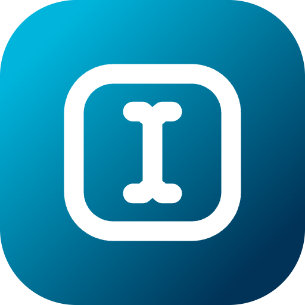

# Spell Key



Spell Key is a [Raycast](https://www.raycast.com/) extension for quickly fixing spelling in selected text.
It uses macOS native spelling suggestions and keeps the workflow keyboard-first.

> [!WARNING]
> Unfortunately, this extension isn't published to the Raycast store.
> So, to run it locally follow the developers extension [docs](https://developers.raycast.com/basics/create-your-first-extension)

> [!NOTE]
> Spell Key only handles spelling suggestions for single word at a time. Grammar correction and rewriting are intentionally out of scope. If you are looking for grammer corrections checkout Raycast's [Inline-Replace](https://www.raycast.com/changelog/macos-beta#0.65)

## Why I built this

I prefer using keyboard for most actions, and I missed the ability to quickly fix spelling mistakes like the `⌘ + .` shortcut in VScode.
The fastest and easiest way I could find was to implement it as a Raycast extension.

## Requirements

- macOS on Apple Silicon.
- Raycast 2.13 or later.

## Usage

1. Select a word or phrase in any app.
2. Open the `Fix Spelling` command in Raycast.
3. Choose a suggestion.
4. Press `Enter` to replace the selection.

## Running locally

```bash
npm install
native/build.sh
npm run dev
```
